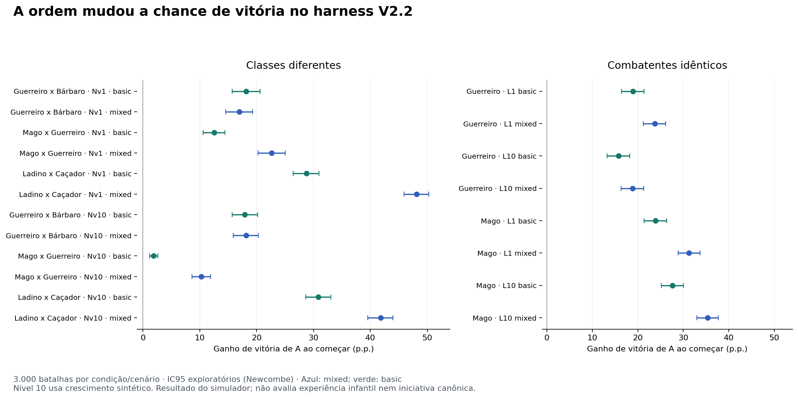

# Fase 3 — efeito da ordem no harness V2.2

Status: PROPOSAL
Domain: técnica
Authority: nenhuma para regras ou balanceamento; evidência experimental
VerifiedAgainst: `e6d550ff427657110500d99cbc3e570cfedde2f6`
Supersedes: nenhum
Data: 28/10/2026

## Resultado

Começar aumentou a chance de vitória do mesmo combatente A nos 20 cenários
selecionados, de **1,90 a 48,13 pontos percentuais**. Todos os intervalos
exploratórios de 95% do delta ficaram acima de zero. O sinal foi positivo nas
três réplicas de cada cenário. Nos oito controles com combatentes idênticos,
o aumento variou de **15,77 a 35,37 p.p.**

Foram executados um piloto de **4.000 batalhas** e uma rodada principal de
**120.000**: 20 cenários × duas condições × 1.000 batalhas × três sementes.
Cada condição acumula 3.000 batalhas por cenário. Repetições determinísticas
para conferir os arquivos não são novas amostras independentes.

Nenhum combate terminou antes da primeira resposta adversária e não houve
empates. A maior diferença absoluta de duração média foi **0,08067 ciclo**.
A ordem mudou a probabilidade de vitória sem mudança comparável na duração.

Não foi definido um limiar humano para diferença material. Os resultados
demonstram efeito detectável nesta bancada; não decidem justiça percebida,
diversão, clareza infantil ou qual iniciativa o jogo deve adotar.



## A — Referência auditada

A main examinada foi `e6d550ff427657110500d99cbc3e570cfedde2f6`. Não havia PR
aberto no repositório principal na consulta inicial. Foram consultados README,
AGENTS, entrada de IA, estado, autoridade, decisões, roadmap, Patch V2.2,
harness, fórmula, runner, comparador, testes de simulação/paridade e workflow.

`simulateScenario()` estabelece a ordem nos dois blocos dentro do `while`:
regenera ENE do jogador, escolhe/paga a ação e ataca; se o inimigo morrer,
interrompe sem regeneração nem ação inimiga. Caso contrário, executa esse
processo para o inimigo. Um turno é um ciclo, que pode terminar com uma só ação.
Ambos começam com HP máximo; nesta matriz, ENE inicial zero e limite 50 ciclos.
Cada ataque usa o confronto e o dano compartilhados, com duas rolagens d20.

A baseline oficial foi gerada com 90 cenários, 1.000 batalhas por cenário e
seed `monstrinhomon-combat-v2.2-baseline-v1`. O comando original levou cerca de
0,18 s de tempo de parede local; não é benchmark comparativo de desempenho.
O comparador oficial registrou **90/90 cenários sem alteração quantitativa**
após a instrumentação. O JSON original e o delta estão versionados junto aos
resultados; a baseline não foi convertida ao formato do novo experimento.

## B — Variante mínima

Foi escolhido o espelhamento completo dos papéis na chamada ao mesmo motor.
Na condição A, A é `player` e atua primeiro. Na condição B, B é `player` e A é
`enemy`. Combatente, skill e política são trocados juntos; vitória e HP são
reconvertidos à identidade física A/B antes da análise. O ID ordenado do par
não define quem é A: isso está explícito em `scenario.player` no JSON.

A simetria é válida para a API inspecionada: não há cura, itens, IA de alvo,
grupos ou regras externas assimétricas. Essa equivalência **não se transfere
a Wild e Group completos**. Uma política futura que diferencie lados exigirá
nova auditoria antes de reutilizar o espelhamento.

A única alteração no harness é uma linha opcional de saída:
`includeBattleRuns: true` expõe os registros já calculados (vencedor, ciclos e
HP de ambos). Por padrão, a opção é falsa: formato, RNG e resultados anteriores
permanecem iguais. Não foi criado outro motor, nem alterado o loop de ações.

O módulo não é importado pela aplicação jogável. O harness quantitativo de
espécies importa funções auxiliares dele, preservadas nesta alteração. Os testes
de paridade e a suíte geral passaram. Nenhuma fórmula, dado de monstro, skill,
passiva, ENE, iniciativa runtime ou regra canônica foi modificada.

## C/D — Configuração e execução

Foram escolhidos Guerreiro × Bárbaro, Mago × Guerreiro e Ladino × Caçador,
mais controles idênticos de Guerreiro e Mago, em níveis 1 e 10 e perfis
`basic`/`mixed`. A matriz usa vantagens direcionais da tabela canônica e
inclui diferenças de atributos, duração e força. O nível 10 usa o crescimento
sintético do harness; não representa automaticamente evolução natural válida.

Entre condições preservam-se dados, HP máximo, ENE inicial, skills, políticas,
passivas de classe e limite. Não foram variados HP ou ENE iniciais nesta fase;
o estudo não pretende cobrir todas as condições possíveis.

O piloto usa 100 batalhas por condição e uma réplica; conferiu contagens,
matriz, repetição e custo. Suas amostras não entram no estimador principal.
A rodada principal usa três réplicas de 1.000 por condição. O lote local levou
618 ms em Node v24.22.1, sem incluir instalação, testes ou geração do gráfico.
Não se usa esse tempo para prever custo em outra máquina.

Cada batalha recebe uma seed composta por raiz, réplica, cenário, ordem e
índice. São streams distintos por condição, não rolagens pareadas por ator.
Encerramentos diferentes consomem quantidades diferentes de RNG, mas não
deslocam o stream da batalha seguinte. As réplicas são streams pseudoaleatórios
distintos; sua independência estatística é pressuposto de Monte Carlo.

A repetição integral confirmou o mesmo hash de resultados:
`df7e920105470f402dc37f65de7d602b3c8ad5203cecad6cd47baa9d429119bc`.
Os manifestos registram configuração, SHA declarado, hashes dos bytes usados,
versão Node e duração. Na execução local, o SHA é a base oficial e os hashes
identificam as modificações experimentais; não se afirma que já estejam na main.

## E — Análise

Taxas usam contagens inteiras; IC95 de proporções: Wilson; IC95 de diferenças:
Newcombe para amostras independentes. São intervalos exploratórios por cenário,
sem correção por múltiplas comparações. Precisão estatística não define
relevância para o design. Não se oculta heterogeneidade em uma taxa global.

| Exemplo | A vence começando | A vence em segundo | Delta p.p. [IC95] |
|---|---:|---:|---:|
| Ladino × Caçador, Nv1, mixed | 84,57% | 36,43% | 48,13 [45,94; 50,25] |
| Guerreiro × Bárbaro, Nv1, basic | 68,47% | 50,30% | 18,17 [15,71; 20,59] |
| Mago × Guerreiro, Nv10, basic | 2,97% | 1,07% | 1,90 [1,20; 2,64] |
| Mago idêntico, Nv10, mixed | 66,93% | 31,57% | 35,37 [32,97; 37,70] |

No maior efeito, o ganho relativo sobre a condição segundo é 132,11%; no
menor, a probabilidade de vitória observada é aproximadamente 2,78 vezes maior
(risco relativo). A segunda razão parece grande, mas a vitória
permanece rara; o delta absoluto de 1,90 p.p. evita essa interpretação enganosa.
O piloto apresentou algumas taxas próximas de zero, sem provar probabilidades
exatamente zero ou um. A principal não encontrou saturação exata de 0%/100%.

Começar oferece a possibilidade de executar o golpe decisivo sem resposta no
último ciclo. A alternância e a parada imediata no código, junto aos contadores
de ações, sustentam esse mecanismo. Não se identifica qual batalha individual
teria virado sob rolagens contrafactuais iguais. O efeito não dependeu de impedir
a primeira participação do adversário: a contagem de combates sem resposta foi zero.

O misto não ampliou o efeito uniformemente. Guerreiro × Bárbaro Nv1 teve delta
18,17 p.p. no básico e 16,93 no misto; Ladino × Caçador Nv1 passou de 28,73 para
48,13. A ENE total nem sempre diminuiu quando A passou a segundo: soma ambos
os lados e depende de quem conseguiu usar habilidades antes da derrota.

HP e dano efetivo seguem o mesmo A nas duas condições. Dano efetivo é HP
perdido, sem overkill; não há cura. Ações por lado são inferidas da alternância
estrita, incluindo erros. ENE e skills são totais dos dois lados, sem atribuição
individual. Mediana/P10/P90 vêm do histograma exato de ciclos; médias incluem
todos os encerramentos. Resultados por réplica, histogramas e contagens estão
nos JSONs. As tabelas completas estão em
[quantitative.md](../../experiments/results/turn-order-v22/quantitative.md).

## F — Validação

| Verificação executada | Resultado |
|---|---:|
| Simulação oficial, main sem alteração | 12/12 |
| Paridade harness/Wild/Group, main sem alteração | 12/12 |
| Paridade de modos das espécies, main sem alteração | 20/20 |
| Paridade final das espécies, main sem alteração | 9/9 |
| Suíte geral após instrumentação | 5.803/5.803, 177 arquivos |
| Novos testes Node do experimento | 8/8 |
| Smoke Wild Loop Vitest | 7/7 |
| Validação de dados | sem erros; oito avisos preexistentes sobre HP |
| Validação de assets | aprovada, sem avisos |
| Comparador oficial antes/depois | 90 cenários idênticos |
| Repetição do piloto e da principal | resultados idênticos |
| E2E local em Chromium | não executado nesta medição; CI existente o executa |

Os 53 testes oficiais estão contidos na suíte geral e não devem ser somados
aos 5.803 como cobertura independente. O novo arquivo `.test.mjs` é executado
explicitamente pelo Node no workflow, pois o Vitest inclui somente `.test.js`.

Os novos testes verificam orçamento inválido, matriz incompleta/classe
desconhecida, espelhamento completo sem mutação, contagens e determinismo,
preservação da saída padrão/RNG, intervalos, empate no limite e controle letal
que detecta inversão real da vantagem com a fórmula existente.

Na primeira validação experimental, a expectativa de contagem foi corrigida:
a matriz original possui mais de um par recíproco. A matriz final selecionada
é explicitamente conferida como 20 casos. Não houve correção de gameplay.

O workflow novo executa testes, piloto, principal, repetição e comparador da
baseline, e publica os resultados por 30 dias. Os JSONs desta execução também
estão versionados, preservando evidência além da retenção dos artifacts.
A fixture da baseline é deliberadamente congelada: futuras mudanças legítimas
em dados/fórmula podem reprovar a comparação e exigirão revisão da referência.

## Reprodução

Na raiz do repositório e branch experimental:

```bash
npm ci
npm run test:combat-simulation-v2-2
npm run test:combat-parity-v2-2
npm run test:species-passive-parity-v2-2
npm run test:species-passive-final-parity-v2-2
node --test tests/turn_order_experiment.test.mjs
node scripts/experiment-turn-order-v22.mjs --source-commit e6d550ff427657110500d99cbc3e570cfedde2f6 --config experiments/configs/turn-order-v22-pilot.json --output artifacts/pilot
node scripts/experiment-turn-order-v22.mjs --source-commit e6d550ff427657110500d99cbc3e570cfedde2f6
npm run simulate:combat-v2-2 -- --runs 1000 --seed monstrinhomon-combat-v2.2-baseline-v1 --baseline-sha e6d550ff427657110500d99cbc3e570cfedde2f6 --output artifacts/reference.json --report artifacts/reference.md
node scripts/compare-combat-baselines-v2-2.mjs --before experiments/results/turn-order-v22/reference-before.json --after artifacts/reference.json --output artifacts/reference-delta.json --report artifacts/reference-delta.md
npm test
npm run validate-data
npm run validate:monster-assets
npm run test:wild-loop:vitest
```

## G — Limites e continuidade

A pergunta delimitada da Fase 3 foi respondida para a matriz selecionada:
começar tem efeito detectável e heterogêneo no modelo ofensivo 1×1 do harness.
O resultado não valida Wild/Group completos, passivas de espécie, cura, itens,
tabuleiro, grupos, SPD + d6, regras futuras de cartas ou experiência infantil.
Não modifica nem resolve `DIV-INIT-01`.

Não há necessidade de ampliar o mesmo lote para detectar o efeito. Um segundo
experimento só é útil se houver uma decisão específica: por exemplo, medir
a ordem no runtime Group atual sob um contrato de ações definido. Isso seria
outra investigação; não está implementado nem autorizado como mudança de regra.

O trabalho fica em branch e PR de rascunho, sem merge. A exploração e os PRs
#5/#6 foram apenas consultados para continuidade e permaneceram sem alterações.
Reversão: reverter o commit experimental; não há migração de dados ou saves.

Arquivos novos: executor experimental, dois configs, testes Node, workflow,
este relatório e evidências em `experiments/results/turn-order-v22/`.
Arquivo modificado: `js/combat/combatSimulationHarness.js`, uma linha de
observação opcional. Não foram introduzidas dependências, serviços ou agentes.
